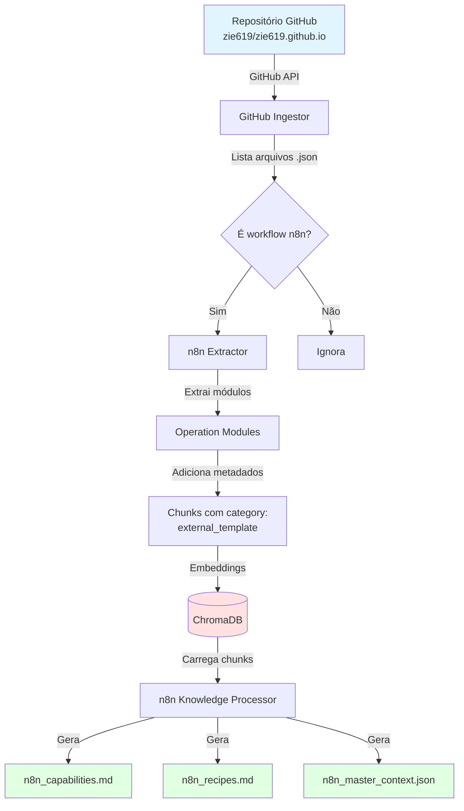
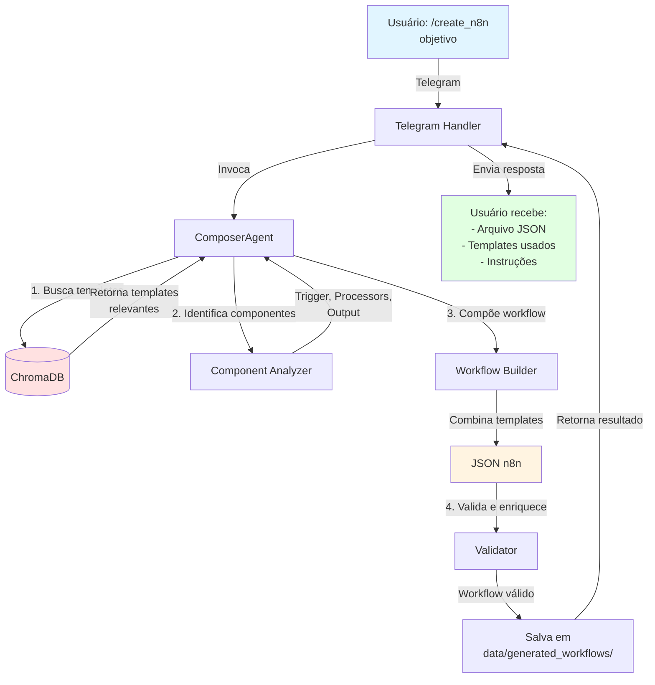
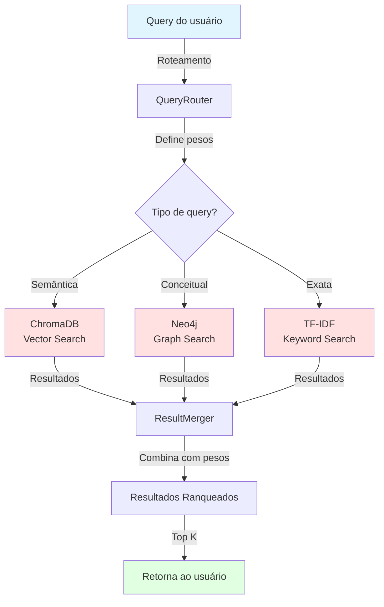
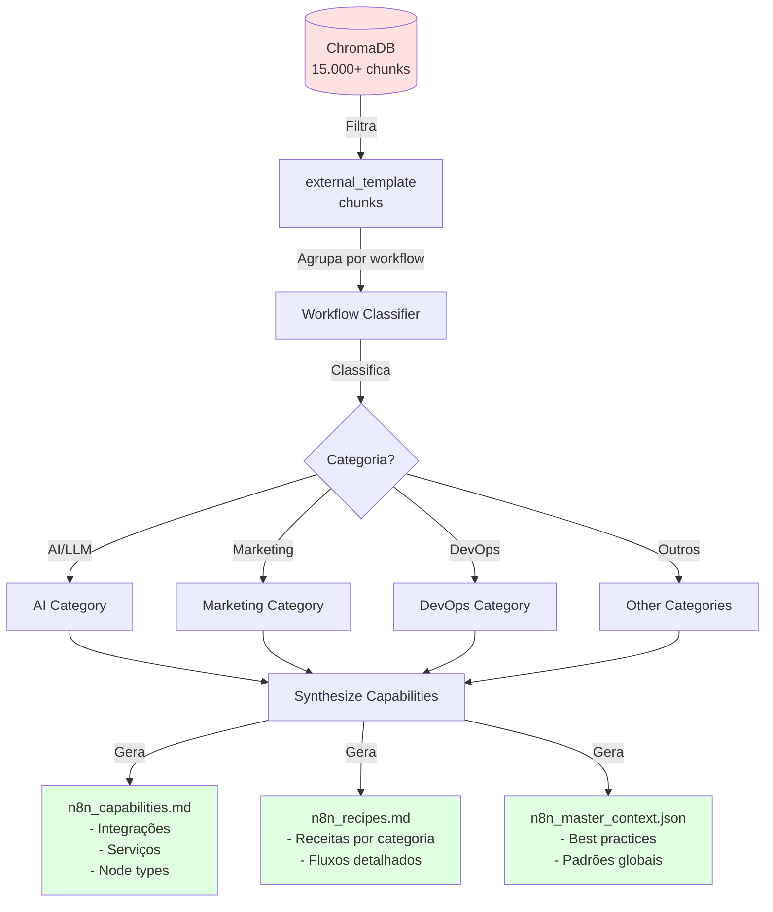
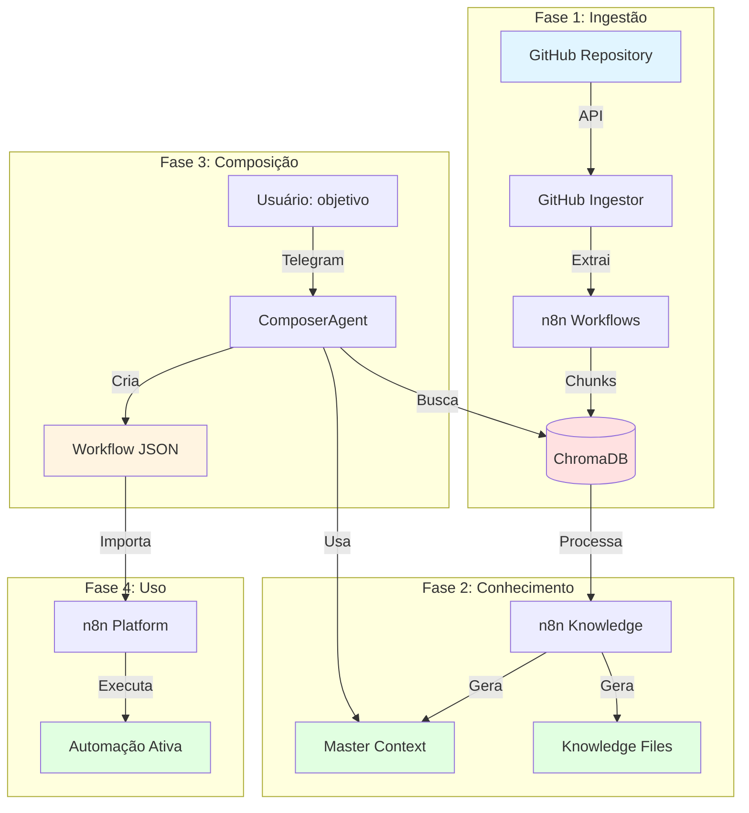
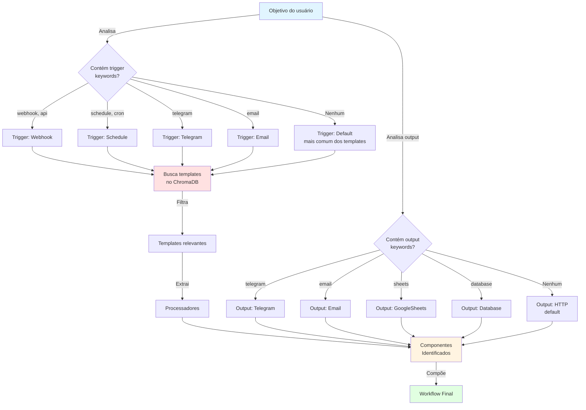
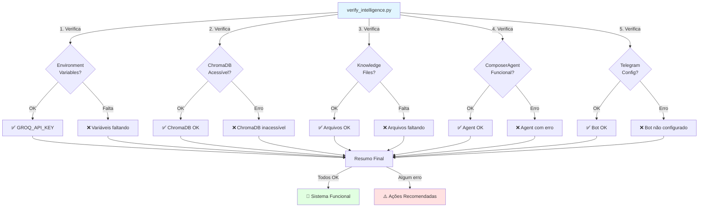
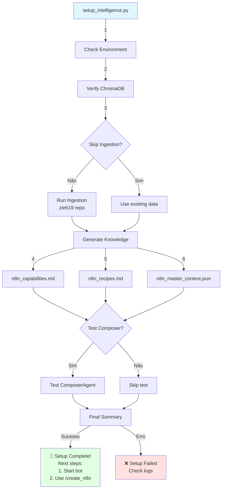
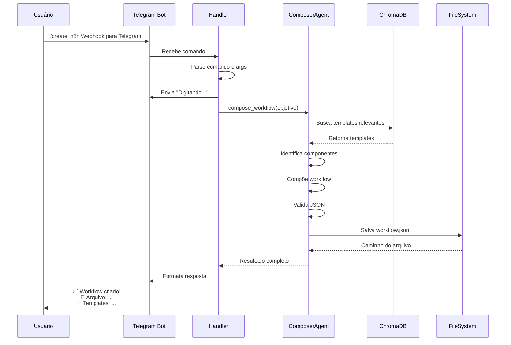
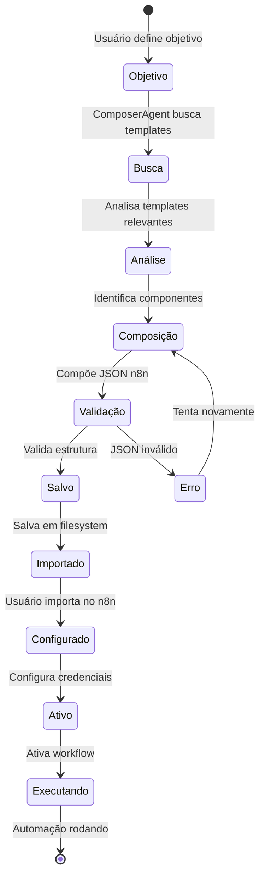

# 🎨 Workflow Diagrams - Bunker Intelligence

Diagramas visuais dos principais fluxos do sistema.

## 📥 Fluxo de Ingestão em Massa

## 🤖 Fluxo do ComposerAgent

## 🔍 Fluxo de Busca Híbrida (HybridRAG)

## 📊 Fluxo de Geração de Conhecimento

## 🔄 Fluxo Completo: Do GitHub ao Workflow

## 🎯 Fluxo de Decisão: Identificação de Componentes

## 🔐 Fluxo de Verificação do Sistema

## 🚀 Fluxo de Setup Automatizado

## 📱 Fluxo de Interação via Telegram

## 🔄 Ciclo de Vida de um Workflow

---

## 📚 Legenda de Cores

- 🔵 **Azul claro** (#e1f5ff): Entrada do usuário / Início
- 🔴 **Vermelho claro** (#ffe1e1): Armazenamento / Banco de dados
- 🟢 **Verde claro** (#e1ffe1): Saída / Resultado final
- 🟡 **Amarelo claro** (#fff4e1): Processamento / Transformação

---

**Última atualização:** 2026-03-03
**Autor:** Hugo (Bunker Intelligence Team)
